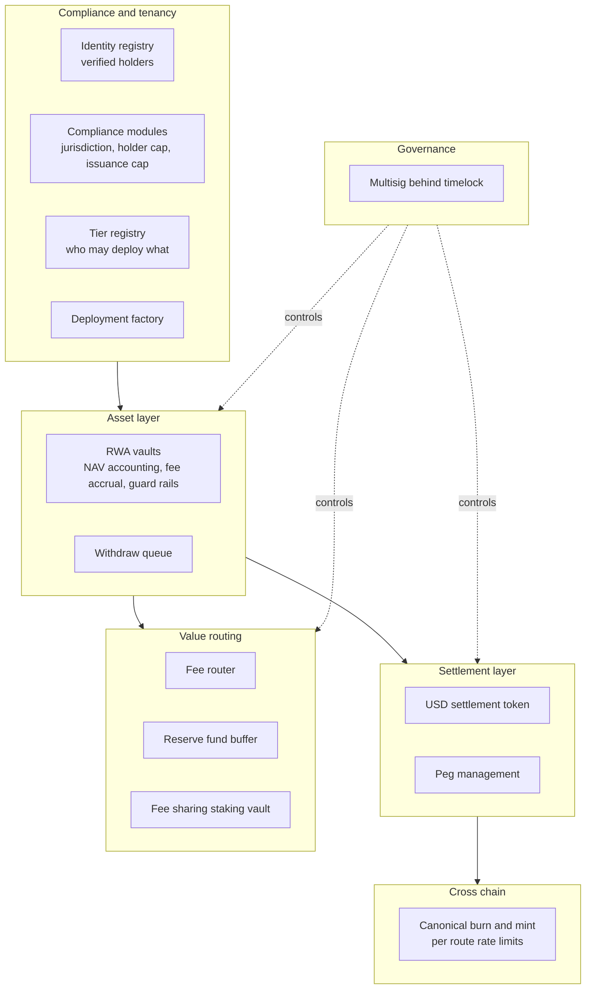
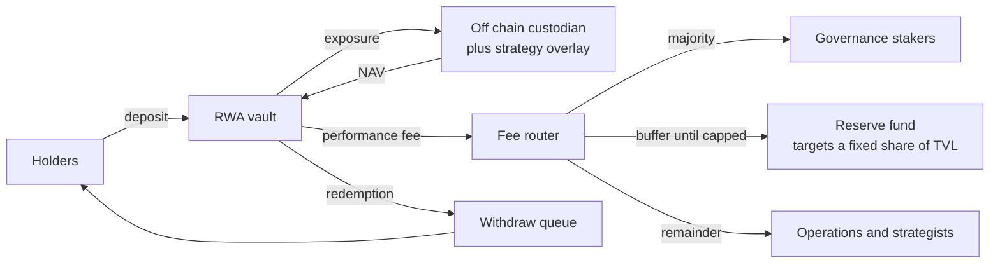
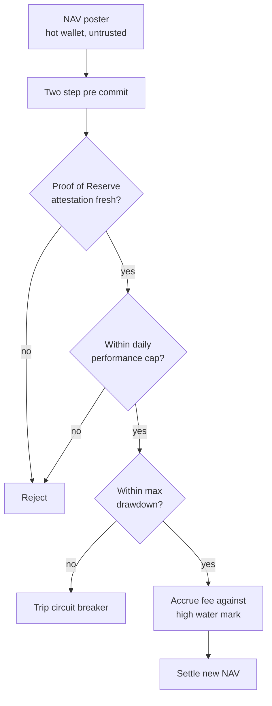
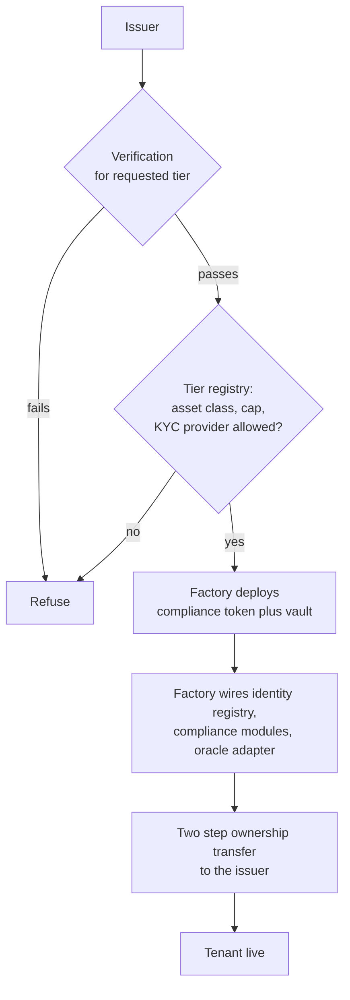
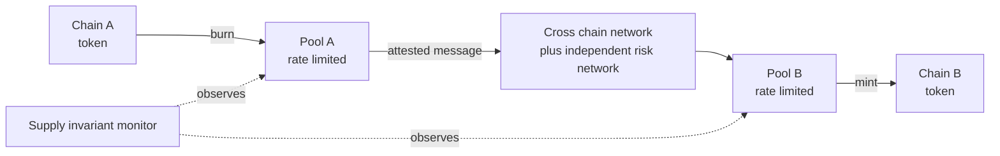

# Architecture Overview

A conceptual map of the system the [decision records](adr/README.md) refer to. No implementation, no interfaces, no parameters. The purpose is to make the decisions legible, not to make the system reproducible.

## The shape of the problem

A tokenized real world asset protocol has to reconcile two things that do not naturally fit together.

**Off chain assets are custodied, slow, and legally wrapped.** A share of an S&P 500 ETF lives with a regulated custodian, settles on business days, and belongs to a legal entity.

**On chain tokens are instant, permissionless, and composable.** That is the entire appeal, and every one of those properties is a liability when the thing being represented is a security.

Everything below is a consequence of bridging that gap without letting either side's assumptions leak into the other.

## Layers

## Value flow

Fees are the only value that leaves a vault, and where they go was fixed rather than discretionary.

The reserve fund absorbs drawdowns before holders are affected, and redirects to stakers once it reaches its target share of TVL. A buffer that grows forever is dead capital, so it stops.

## The NAV update path

This is the most security sensitive path in the system, because it is the only place where an off chain fact becomes an on chain number that determines what everyone's shares are worth.

Four properties matter here, and each is a decision rather than a default.

**The NAV poster is a hot wallet and is treated as untrusted.** It has to be a hot wallet because NAV updates are frequent and a multisig cannot sign daily. So the design assumption is that the key is compromised, and every control exists to bound what a compromised key can do.

**Every guard fails closed.** A stale oracle, a value outside the daily cap, or a drawdown past the breaker stops the update. A NAV system that fails open on a stale feed is a NAV system with no oracle.

**The two step pre commit exists because NAV updates are front runnable.** An observer who sees a favorable update in the mempool can deposit ahead of it and capture value that belongs to existing holders. Committing first and revealing after removes the free option.

**Fees accrue against a high water mark.** A performance fee that is charged on recovery from a loss charges holders twice for the same gain.

## Tenant deployment

The platform path from [ADR 0002](adr/0002-whitelabel-platform-before-first-party-assets.md) and [ADR 0003](adr/0003-tiered-access-model.md).

Two things are load bearing.

**The tier check is on chain, in the factory.** Not in the API. A gate that only exists in the interface is bypassed by calling the contract directly, which means it was never a control. See [ADR 0003](adr/0003-tiered-access-model.md).

**Ownership transfer is two step.** The issuer must actively accept. One step transfers to a mistyped address are unrecoverable, and here that would strand a security token with no admin.

## Cross chain supply

Burn and mint rather than lock and wrap, so supply stays canonical and there is no wrapped variant to depeg. The monitor is not optional: cumulative destination mints exceeding cumulative source burns means protocol level inflation, and that has to page someone rather than appear in a report. Reasoning in [ADR 0001](adr/0001-chainlink-ccip-over-layerzero-oft.md).

## Trust boundary

The honest version, which is the one that belongs in a threat model.

**Trusted.** The governance multisig behind a timelock. The off chain custodian holding the actual assets. The oracle infrastructure providing prices and reserve attestations. The cross chain infrastructure.

**Untrusted, and bounded by design.** The NAV poster hot wallet. The peg management bot. The bridge pools. Every DEX participant arbitraging the peg, whose ordinary self interested trading is what maintains it.

**The residual risk that cannot be engineered away.** Custodian solvency. The protocol can check a Proof of Reserve attestation, hold a reserve buffer, and publish. It cannot make a custodian solvent. Every real world asset protocol has this exposure and the ones that claim otherwise have relocated it rather than removed it.

**The invariant everything was designed toward:** no single private key can drain the protocol in one transaction. Every total loss path routes through the timelock, where there is time to react, or requires the custodian to actively collude. See [ADR 0006](adr/0006-security-sequencing-under-a-fixed-audit-budget.md).
